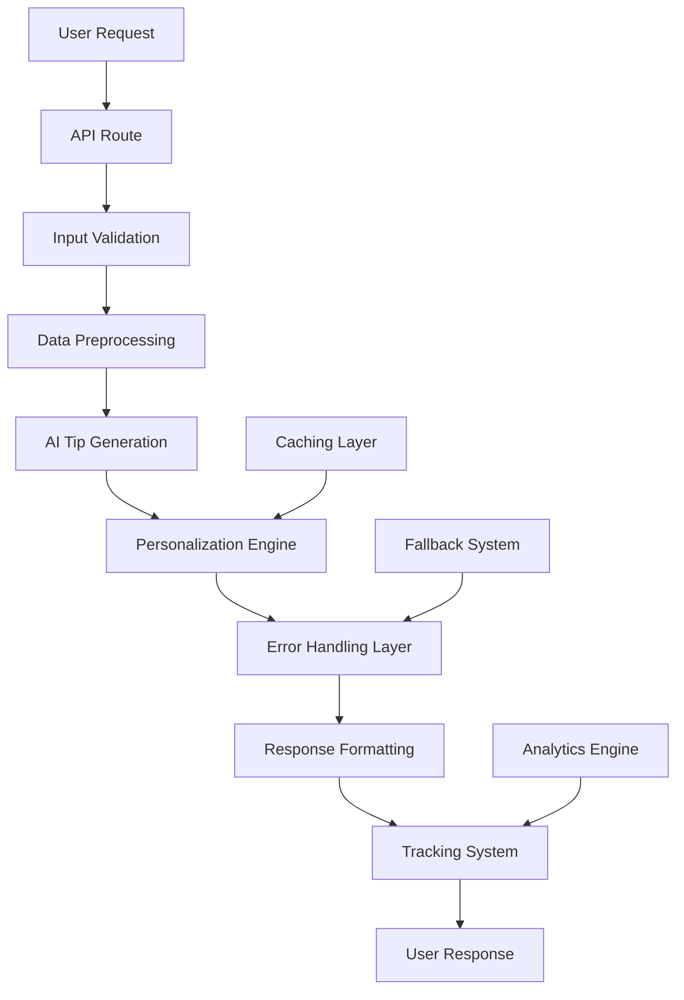

# Enhanced Daily Tips System Documentation

## 📋 Table of Contents

1. [Overview](#overview)
2. [Migration Guide](#migration-guide)
3. [Architecture](#architecture)
4. [API Documentation](#api-documentation)
5. [Features](#features)
6. [Usage Examples](#usage-examples)
7. [Configuration](#configuration)
8. [Troubleshooting](#troubleshooting)
9. [Performance Optimization](#performance-optimization)
10. [Testing](#testing)

---

## 🎯 Overview

The Enhanced Daily Tips System is a complete rewrite of the original daily tips functionality, designed to provide:

- **🧠 AI-Powered Personalization**: Intelligent tip recommendations based on user behavior
- **📊 Advanced Analytics**: Comprehensive tracking and performance insights  
- **🔄 Robust Error Handling**: Graceful degradation and retry mechanisms
- **⚡ Production-Ready**: Optimized for scalability and reliability
- **🎨 Enhanced UX**: Improved user interface and interaction patterns

### Key Improvements Over Legacy System

| Feature | Legacy System | Enhanced System |
|---------|---------------|-----------------|
| **Personalization** | Basic static tips | AI-driven personalized recommendations |
| **Error Handling** | Basic try/catch | Comprehensive error classification & fallbacks |
| **Analytics** | No tracking | Full tracking with behavior analysis |
| **Performance** | Single API calls | Cached responses with optimization |
| **UI/UX** | Basic display | Interactive feedback system |
| **Scalability** | Limited | Production-ready with rate limiting |

---

## 🚀 Migration Guide

### 1. Prerequisites

Ensure you have:
- ✅ Next.js 13+ with App Router
- ✅ TypeScript support
- ✅ Gemini API key configured
- ✅ Firebase/Firestore setup (for user data)

### 2. Installation Steps

#### Step 1: Update Dependencies
```bash
npm install zod @google/generative-ai
```

#### Step 2: Environment Variables
Add to your `.env.local`:
```env
GEMINI_API_KEY=your_gemini_api_key_here
```

#### Step 3: Type Definitions
The new system uses enhanced TypeScript types. No action needed - types are automatically available.

#### Step 4: API Routes
New API routes are already created. Verify these exist:
- `/api/daily-tips`
- `/api/daily-insights` 
- `/api/daily-sidebar-tip`
- `/api/smart-suggestions`
- `/api/habit-stacking`
- `/api/energy-optimization`

### 3. Code Migration

#### Old Usage (Legacy):
```typescript
// OLD - Direct server function import
import { getDailyTips } from '@/ai/flows/daily-tips';

const tips = await getDailyTips({
  schedule: scheduleData,
  apiKey: apiKey
});
```

#### New Usage (Enhanced):
```typescript
// NEW - API route calls
const response = await fetch('/api/daily-tips', {
  method: 'POST',
  headers: { 'Content-Type': 'application/json' },
  body: JSON.stringify({
    schedule: scheduleData,
    historicalPatterns: patterns,
    userPreferences: preferences,
    contextualData: context,
    apiKey: apiKey
  })
});

const tips = await response.json();
```

### 4. Context Integration

Update your context usage:

```typescript
// Use the enhanced context methods
const { 
  generateDailyTips,     // Enhanced tip generation
  trackTipInteraction,   // New tracking functionality
  getTipAnalytics       // New analytics
} = useTimeBubbles();
```

---

## 🏗️ Architecture

### System Components



### Core Modules

#### 1. **AI Generation Layer** (`/src/ai/flows/`)
- `daily-tips.ts` - Core tip generation logic
- `daily-insights.ts` - Insight generation
- `energy-optimization.ts` - Energy-based recommendations
- `habit-stacking.ts` - Habit formation tips
- `smart-suggestions.ts` - Context-aware suggestions

#### 2. **Personalization Engine** (`/src/lib/tip-personalization-engine.ts`)
- Machine learning-based personalization
- User behavior pattern analysis
- Adaptive recommendation scoring
- Preference learning algorithms

#### 3. **Tracking System** (`/src/lib/tip-tracking-system.ts`)
- User interaction tracking
- Performance analytics
- Effectiveness measurement
- Improvement recommendations

#### 4. **Error Handling** (`/src/lib/tips-error-handler.ts`)
- Comprehensive error classification
- Retry mechanisms with exponential backoff
- Graceful degradation
- Fallback content generation

#### 5. **Type System** (`/src/types/ai-types.ts`)
- Enhanced TypeScript interfaces
- Zod schema validation
- Runtime type checking
- API contract definitions

---

## 📡 API Documentation

### POST /api/daily-tips

Generates personalized daily tips based on user data and preferences.

#### Request Body
```typescript
interface DailyTipsInput {
  schedule: string;                    // JSON string of time blocks
  historicalPatterns?: string;         // JSON string of historical data
  userPreferences?: string;            // JSON string of user preferences
  contextualData?: string;             // JSON string of contextual info
  previousTipsFeedback?: string;       // JSON string of feedback history
  userGoals?: string;                  // JSON string of user goals
  apiKey: string;                      // Gemini API key
}
```

#### Response
```typescript
interface TipsResponse {
  success: boolean;
  data?: {
    tips: EnhancedTip[];
    summary: TipsSummary;
    analytics: TipsAnalytics;
  };
  error?: TipError;
  fallbackData?: DailyTips;
}
```

#### Example Request
```javascript
const response = await fetch('/api/daily-tips', {
  method: 'POST',
  headers: { 'Content-Type': 'application/json' },
  body: JSON.stringify({
    schedule: JSON.stringify(timeBlocks),
    historicalPatterns: JSON.stringify(patterns),
    userPreferences: JSON.stringify({
      preferredCategories: ['Health', 'Productivity'],
      tipStyle: 'detailed',
      focusAreas: ['morning-routine']
    }),
    apiKey: process.env.GEMINI_API_KEY
  })
});

const result = await response.json();
```

### Other API Endpoints

#### POST /api/daily-insights
Generates analytical insights about daily performance.

#### POST /api/daily-sidebar-tip  
Provides contextual tips for the sidebar display.

#### POST /api/smart-suggestions
Offers intelligent suggestions based on current context.

#### POST /api/habit-stacking
Generates habit stacking recommendations.

#### POST /api/energy-optimization
Provides energy management and optimization tips.

---

## ✨ Features

### 1. **Enhanced Tip Personalization**

```typescript
// Automatic personalization based on:
- User behavior patterns
- Historical performance data
- Time-based preferences
- Category effectiveness
- Feedback learning
```

### 2. **Comprehensive Error Handling**

```typescript
// Error categories handled:
- AUTHENTICATION (API key issues)
- RATE_LIMIT (API quota exceeded)
- NETWORK (Connection problems)
- VALIDATION (Input errors)
- AI_SERVICE (Model unavailable)
- TIMEOUT (Request timeouts)
```

### 3. **Advanced Analytics**

```typescript
// Tracking capabilities:
- Tip view/interaction rates
- Implementation success rates
- User engagement patterns
- Effectiveness scoring
- Improvement recommendations
```

### 4. **Intelligent Fallbacks**

```typescript
// Fallback strategies:
- Static tip library for offline use
- Cached previous recommendations
- Category-based defaults
- Progressive degradation
```

---

## 💡 Usage Examples

### Basic Tip Generation

```typescript
import { useTimeBubbles } from '@/context/time-bubbles-context';

function DailyTipsComponent() {
  const { generateDailyTips, isLoadingTips } = useTimeBubbles();
  
  const handleGenerateTips = async () => {
    try {
      await generateDailyTips();
    } catch (error) {
      console.error('Failed to generate tips:', error);
    }
  };
  
  return (
    <button 
      onClick={handleGenerateTips}
      disabled={isLoadingTips}
    >
      {isLoadingTips ? 'Generating...' : 'Get Daily Tips'}
    </button>
  );
}
```

### Tracking Tip Interactions

```typescript
import { TipTrackingSystem } from '@/lib/tip-tracking-system';

function TipCard({ tip }) {
  const trackingSystem = TipTrackingSystem.getInstance();
  
  const handleTipView = () => {
    trackingSystem.trackTipInteraction(tip.id, 'viewed');
  };
  
  const handleTipImplementation = () => {
    trackingSystem.trackTipInteraction(tip.id, 'implemented');
    trackingSystem.recordTipImplementation({
      tipId: tip.id,
      implementedAt: new Date(),
      completionStatus: 'complete',
      difficulty: 'as_expected',
      timeSpent: 30
    });
  };
  
  return (
    <div onMouseEnter={handleTipView}>
      <h3>{tip.title}</h3>
      <p>{tip.suggestion}</p>
      <button onClick={handleTipImplementation}>
        Mark as Implemented
      </button>
    </div>
  );
}
```

### Custom Personalization

```typescript
import { TipPersonalizationEngine } from '@/lib/tip-personalization-engine';

function PersonalizationSettings() {
  const engine = TipPersonalizationEngine.getInstance();
  
  const updatePreferences = (preferences) => {
    engine.updateUserPreferences(preferences);
  };
  
  const getRecommendations = () => {
    return engine.getImprovementRecommendations();
  };
  
  return (
    <div>
      {/* Preference controls */}
      <PreferenceControls onUpdate={updatePreferences} />
      
      {/* Recommendations display */}
      <RecommendationsList recommendations={getRecommendations()} />
    </div>
  );
}
```

---

## ⚙️ Configuration

### Environment Variables

```env
# Required
GEMINI_API_KEY=your_gemini_api_key

# Optional - Performance tuning
TIPS_CACHE_DURATION=3600000          # 1 hour in ms
TIPS_MAX_RETRIES=3                   # Max retry attempts
TIPS_TIMEOUT=30000                   # 30 seconds timeout
TIPS_RATE_LIMIT=100                  # Requests per hour
```

### Personalization Settings

```typescript
// Configure in tip-personalization-engine.ts
export const PERSONALIZATION_CONFIG = {
  LEARNING_RATE: 0.1,                 // How fast to adapt to feedback
  MINIMUM_FEEDBACK_COUNT: 5,          // Min feedback before personalizing
  PATTERN_CONFIDENCE_THRESHOLD: 0.6,  // Pattern detection threshold
  DIVERSITY_WEIGHT: 0.3,              // Balance between relevance and variety
  MAX_TIP_HISTORY: 100,               // Max tips to track per user
  FEEDBACK_RETENTION_DAYS: 90         // How long to keep feedback data
};
```

### Error Handling Configuration

```typescript
// Configure in tips-error-handler.ts
export const ERROR_CONFIG = {
  MAX_RETRIES: 3,
  BASE_DELAY: 1000,                   // Initial retry delay (ms)
  MAX_DELAY: 10000,                   // Maximum retry delay (ms)
  TIMEOUT: 30000,                     // Request timeout (ms)
  CIRCUIT_BREAKER_THRESHOLD: 5,       // Failures before circuit opens
  CIRCUIT_BREAKER_RESET_TIME: 60000   // Time before circuit resets (ms)
};
```

---

## 🔧 Troubleshooting

### Common Issues

#### 1. **API Rate Limit Exceeded**
```
Error: 429 Too Many Requests - API rate limit exceeded
```

**Solutions:**
- Verify API key is valid and has quota
- Implement request throttling
- Use caching to reduce API calls
- Consider upgrading API plan

#### 2. **Invalid API Key**
```
Error: Invalid API Key. Please check your key in the settings.
```

**Solutions:**
- Check `.env.local` file has correct key
- Verify key format (should start with specific prefix)
- Regenerate key in Google Cloud Console
- Ensure key has Gemini API access

#### 3. **Build Errors**
```
Error: Parsing ecmascript source code failed
```

**Solutions:**
- Check for escaped quotes in JSX: `\"` should be `"`
- Verify TypeScript syntax in type definitions
- Look for missing semicolons or commas
- Run `npm run build` to identify exact issues

#### 4. **Server Components Error**
```
Error: An error occurred in the Server Components render
```

**Solutions:**
- Use API routes instead of direct server function imports
- Avoid calling server actions from client components
- Ensure proper `'use client'` and `'use server'` directives

### Debug Mode

Enable detailed logging:

```typescript
// In development, set debug mode
localStorage.setItem('tips_debug_mode', 'true');

// This will log:
// - API request/response details
// - Personalization scoring
// - Error handling steps
// - Performance metrics
```

### Performance Monitoring

```typescript
// Monitor API performance
const startTime = Date.now();
const result = await fetch('/api/daily-tips', options);
const duration = Date.now() - startTime;
console.log(`Daily tips API took ${duration}ms`);
```

---

## ⚡ Performance Optimization

### 1. **Caching Strategy**

```typescript
// Implement response caching
const cacheKey = `tips_${userId}_${dateKey}`;
const cached = localStorage.getItem(cacheKey);

if (cached && !isExpired(cached)) {
  return JSON.parse(cached);
}

// Generate new tips and cache
const tips = await generateTips();
localStorage.setItem(cacheKey, JSON.stringify({
  data: tips,
  timestamp: Date.now(),
  expiresIn: 3600000 // 1 hour
}));
```

### 2. **Request Optimization**

```typescript
// Batch multiple AI requests
const batchRequest = async () => {
  const [tips, insights, suggestions] = await Promise.all([
    fetch('/api/daily-tips', tipOptions),
    fetch('/api/daily-insights', insightOptions),
    fetch('/api/smart-suggestions', suggestionOptions)
  ]);
  
  return {
    tips: await tips.json(),
    insights: await insights.json(),
    suggestions: await suggestions.json()
  };
};
```

### 3. **Memory Management**

```typescript
// Cleanup old tracking data
const trackingSystem = TipTrackingSystem.getInstance();
trackingSystem.cleanupOldData(30); // Keep 30 days of data

// Limit personalization history
const engine = TipPersonalizationEngine.getInstance();
engine.limitHistorySize(100); // Keep 100 most recent interactions
```

---

## 🧪 Testing

### Unit Tests

Run comprehensive test suite:

```bash
npm test
```

Test files included:
- `daily-tips-integration.test.ts` - End-to-end tip generation flow
- `tip-tracking-system.test.ts` - Analytics and tracking functionality  
- `tips-error-handler.test.ts` - Error handling and recovery
- `tip-personalization-engine.test.ts` - Personalization algorithms

### Manual Testing Checklist

#### Basic Functionality
- [ ] Tips generate successfully with valid input
- [ ] Error handling works with invalid API key
- [ ] Rate limiting properly enforced
- [ ] Fallback tips provided when AI unavailable

#### Personalization
- [ ] User preferences affect tip recommendations
- [ ] Feedback improves future recommendations
- [ ] Tip diversity maintained across sessions
- [ ] Performance patterns influence suggestions

#### Analytics
- [ ] Tip interactions properly tracked
- [ ] Implementation rates calculated correctly
- [ ] User engagement metrics updated
- [ ] Analytics insights generated

### Load Testing

Test API performance under load:

```javascript
// Simple load test
const testLoad = async () => {
  const requests = Array(10).fill(null).map(() => 
    fetch('/api/daily-tips', {
      method: 'POST',
      headers: { 'Content-Type': 'application/json' },
      body: JSON.stringify(testData)
    })
  );
  
  const results = await Promise.all(requests);
  console.log('All requests completed:', results.length);
};
```

---

## 📊 Monitoring and Analytics

### Health Checks

```typescript
// API health check endpoint
const healthCheck = async () => {
  const response = await fetch('/api/daily-tips/health');
  return response.ok;
};
```

### Performance Metrics

Monitor key metrics:
- **Response Time**: Average API response time
- **Success Rate**: Percentage of successful requests
- **Error Rate**: Percentage of failed requests
- **Cache Hit Rate**: Percentage of cached responses
- **User Engagement**: Tip interaction rates

### Error Tracking

```typescript
// Error monitoring integration
import { ErrorReporting } from '@/lib/error-reporting';

try {
  await generateTips();
} catch (error) {
  ErrorReporting.captureException(error, {
    context: 'daily-tips-generation',
    userId: user.id,
    timestamp: new Date().toISOString()
  });
}
```

---

## 🔄 Maintenance

### Regular Tasks

1. **Weekly**: Review error logs and performance metrics
2. **Monthly**: Analyze user engagement trends
3. **Quarterly**: Update AI prompts and personalization algorithms
4. **As needed**: Tune configuration parameters

### Updates and Migrations

When updating the system:

1. **Backup current configuration**
2. **Test changes in staging environment** 
3. **Monitor error rates post-deployment**
4. **Rollback plan ready**

### Data Cleanup

```typescript
// Automated cleanup job
const cleanupJob = async () => {
  // Remove old tracking data
  trackingSystem.cleanupOldData(90);
  
  // Clear expired cache entries
  cacheManager.clearExpired();
  
  // Archive old analytics data
  analyticsManager.archiveOldData(365);
};
```

---

## 📞 Support

### Getting Help

1. **Check this documentation first**
2. **Review test files for usage examples**
3. **Check browser console for error details**
4. **Enable debug mode for detailed logging**

### Reporting Issues

When reporting issues, include:
- Error message and stack trace
- Steps to reproduce
- Browser and environment details
- API key status (without revealing the key)

---

## 🔄 Changelog

### Version 2.0.0 (Current)
- ✅ Complete system rewrite
- ✅ AI-powered personalization
- ✅ Comprehensive error handling
- ✅ Advanced analytics and tracking
- ✅ Production-ready architecture
- ✅ Enhanced user experience

### Migration from 1.x
- ❌ Legacy direct function imports
- ✅ New API route architecture
- ✅ Enhanced type safety
- ✅ Improved error handling
- ✅ Better performance optimization

---

*This documentation covers the complete Enhanced Daily Tips System. For additional support or questions, refer to the test files and source code for detailed implementation examples.*